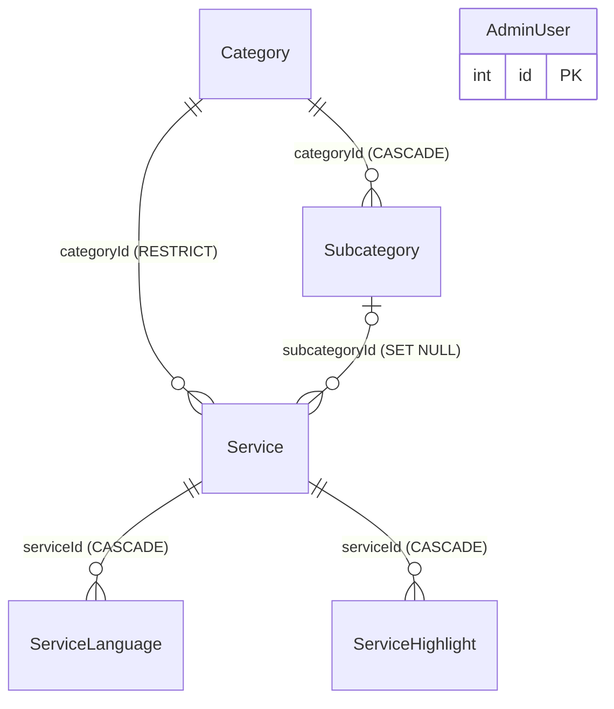

# PAL-ONE — Database Design

- **Engine:** SQLite, managed with Prisma ORM 6.
- **Schema:** `database/prisma/schema.prisma`
- **Migrations:** `database/prisma/migrations/`
- **Seed:** `database/prisma/seed.ts` (data in `seed-data.ts`)
- **Development database:** `database/dev.db` (`DATABASE_URL="file:../dev.db"`, resolved relative to the schema file)

## Entity relationships

| Relationship | Cardinality | On delete of parent |
|---|---|---|
| Category → Subcategory | 1 : N | **Cascade**: a category's subcategories are removed with it |
| Category → Service | 1 : N (required) | **Restrict**: a category with services cannot be deleted |
| Subcategory → Service | 1 : N (optional) | **Set null**: services stay, uncategorized at the subcategory level |
| Service → ServiceLanguage | 1 : N | Cascade |
| Service → ServiceHighlight | 1 : N | Cascade |
| AdminUser | standalone | — |

## Tables

Types are the SQLite storage types Prisma generates: `INTEGER`, `TEXT`, `BOOLEAN` (stored as integer), and `DATETIME` (stored as Unix ms).

### Category

| Column | Type | Constraints / default | Notes |
|---|---|---|---|
| id | INTEGER | PK, autoincrement | internal; never exposed by the API |
| slug | TEXT | **UNIQUE**, required | URL identifier (`education`) |
| nameAr, nameEn | TEXT | required | |
| descriptionAr, descriptionEn | TEXT | required | |
| taglineAr, taglineEn | TEXT | default `''` | short line on cards |
| headlineAr, headlineEn | TEXT | default `''` | hero headline on the category page |
| icon | TEXT | required | one of `CATEGORY_ICONS` (`shared/constants.ts`) |
| tint | TEXT | default `'mist'` | one of `CATEGORY_TINTS` |
| image | TEXT | nullable | future category image |
| sortOrder | INTEGER | default 0 | display order |
| isActive | BOOLEAN | default true | inactive categories and their services are hidden |
| createdAt / updatedAt | DATETIME | default now / auto-updated | |

Index: `(isActive, sortOrder)`.

### Subcategory

| Column | Type | Constraints / default | Notes |
|---|---|---|---|
| id | INTEGER | PK | |
| slug | TEXT | **UNIQUE** (global) | used directly in `?subcategory=` |
| nameAr, nameEn | TEXT | required | |
| descriptionAr, descriptionEn | TEXT | default `''` | |
| sortOrder | INTEGER | default 0 | |
| categoryId | INTEGER | **FK → Category.id**, cascade | |
| createdAt / updatedAt | DATETIME | | |

Index: `(categoryId, sortOrder)`. This also serves as the FK index.

### Service

| Column | Type | Constraints / default | Notes |
|---|---|---|---|
| id | INTEGER | PK | |
| slug | TEXT | **UNIQUE** | |
| nameAr, nameEn, descriptionAr, descriptionEn | TEXT | required | |
| logo | TEXT | nullable | |
| categoryId | INTEGER | **FK → Category.id**, restrict | |
| subcategoryId | INTEGER | nullable, **FK → Subcategory.id**, set null | must belong to the same category (enforced by the seed and checked in the audit) |
| serviceType | TEXT | required | `website` · `mobile-app` · `website-and-app` |
| location | TEXT | required | `LOCATIONS` in `shared/constants.ts` |
| officialWebsite, googlePlayUrl, appStoreUrl | TEXT | nullable | stay `NULL` until confirmed with the provider |
| contactEmail, contactPhone | TEXT | nullable | |
| isFeatured | BOOLEAN | default false | |
| isVerified | BOOLEAN | default false | |
| isDemo | BOOLEAN | default false | true for seed or sample content |
| status | TEXT | default `'draft'` | `draft` · `published` · `archived`; only `published` is public |
| sortOrder | INTEGER | default 0 | curated "recommended" order |
| searchText | TEXT | default `''` | normalized search column (see below); never exposed |
| createdAt / updatedAt | DATETIME | | `createdAt` is used as "date added" |

Indexes: `(status, categoryId)`, `(status, subcategoryId)`, `(status, isFeatured)`, `(status, createdAt)` and `(status, location)`. Every public query filters on `status = 'published'`, so `status` leads each index.

### ServiceLanguage

| Column | Type | Constraints |
|---|---|---|
| serviceId | INTEGER | **PK part**, FK → Service.id, cascade |
| language | TEXT | **PK part**, `ar` or `en` |

The composite primary key `(serviceId, language)` prevents duplicates and indexes lookups by service.

### ServiceHighlight

| Column | Type | Constraints |
|---|---|---|
| id | INTEGER | PK |
| serviceId | INTEGER | FK → Service.id, cascade |
| position | INTEGER | default 0 |
| titleAr, titleEn, textAr, textEn | TEXT | required |

Index: `(serviceId, position)`.

### AdminUser

| Column | Type | Constraints / default | Notes |
|---|---|---|---|
| id | INTEGER | PK | |
| name | TEXT | required | |
| email | TEXT | **UNIQUE** | stored lower-cased by the CLI |
| passwordHash | TEXT | required | `scrypt$N$salt$hash`; plain passwords are never stored |
| role | TEXT | default `'editor'` | `admin` · `editor` |
| createdAt / updatedAt | DATETIME | | |

No public endpoint reads this table. Create admins with `npm run admin:create` (see `database/README.md`).

## Design decisions

- **TEXT columns instead of enums.** Prisma's SQLite connector has no native enum type. Allowed values live in `shared/constants.ts` and are enforced by Zod on input and by the seed.
- **Normalized search column.** SQLite `LIKE` only folds ASCII case. `searchText` stores a normalized copy of the names and descriptions in both languages, plus the category and subcategory names:
  - lower-cased;
  - diacritics and tatweel removed;
  - أ/إ/آ/ٱ→ا, ة→ه, ى→ي, ؤ→و, ئ→ي;
  - punctuation and wildcards turned into spaces.

  The normalization is defined once, in `shared/search.ts` and `shared/text.ts`.
- **Global slug uniqueness** for categories, subcategories and services keeps URLs stable and filters simple.
- **`isDemo` flag** separates sample content from real listings. The seed only touches records whose slugs appear in the seed data.
- **Language and highlight tables** keep `Service` normalized instead of storing lists in text columns.

## Review results (this audit)

The review found no schema change was required, so no new migration was created. Relationships, unique constraints and indexes match every query the API runs. Integrity and foreign-key checks pass on the current data (see `PROJECT_AUDIT.md` §3).

Candidates for later migrations:

- an `@@index([status, sortOrder])` index for large catalogs;
- `AdminUser.lastLoginAt` once authentication exists;
- full-text search (FTS5), if the catalog grows large.
