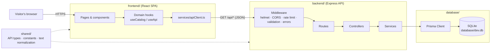
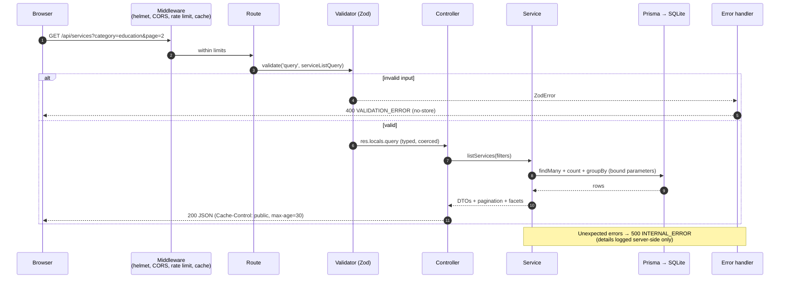
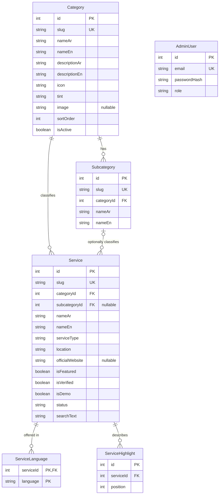
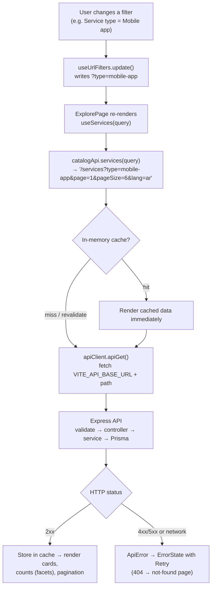
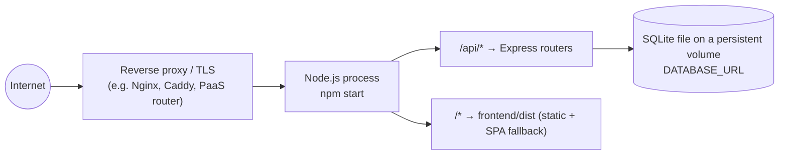

# PAL-ONE — System Design

## 1. Project overview

PAL-ONE ("All Palestinian Digital Services. One Place.") is a public, bilingual (Arabic RTL / English LTR) directory of Palestinian websites, apps and organizations. People browse and search listings, then continue to the provider's official platform. PAL-ONE itself provides no transactions, accounts or user data storage.

| Concern | Choice |
|---|---|
| Frontend | React 18 · TypeScript · Vite · Tailwind CSS v4 · React Router 7 · Lucide |
| Backend | Node.js 22 · Express 5 · TypeScript · Zod · Helmet · CORS · express-rate-limit |
| Database | SQLite · Prisma ORM 6 |
| Shared contract | `shared/` TypeScript modules imported by both sides |
| Repository | npm workspaces (`frontend`, `backend`) + `database/`, `docs/`, `shared/` |

## 2. System architecture



- The browser only ever talks to the HTTP API. The SQLite file is reachable only by the backend process.
- In development, Vite serves the SPA on `:5173` and proxies `/api` to Express on `:4000`. In production, one Express process serves both the API and `frontend/dist`.

## 3. Frontend architecture

```
frontend/src/
├── pages/        Route-level screens (Discover, Categories, Category results, Explore, Search, Service detail, Legal, 404)
├── layouts/      MainLayout: header, footer, skip link, scroll management
├── components/   Reusable UI: ServiceCard, CategoryCard/Tile, SearchBar, Select, Pagination, StatusViews …
├── hooks/        useCatalog (domain data), useApi (fetch/cache/abort), useUrlFilters, useLanguage …
├── services/     apiClient.ts (base URL, errors) · catalogApi.ts (typed endpoint paths)
├── i18n/         ar.ts / en.ts dictionaries (type-checked to the same shape) · LanguageContext
├── types/        Re-exports of the shared API contract + UI-only types
├── utils/        Formatting helpers
└── assets/       Static assets bundled by Vite
```

Principles:

- **No fetch calls in pages.** Pages call domain hooks (`useServices(query)`, `useCategory(slug, 0)` …). Hooks call `useApi`, which goes through the single `apiClient`.
- **URL as state.** Filters, sort and page live in the query string (`useUrlFilters`), so results can be shared and survive a reload or the back button.
- **Resilient loading.** Previous results stay visible while new ones load, stale requests are aborted, and responses are cached (LRU, 100 entries). Every data view has skeleton, error (with retry) and empty states.
- **Bilingual by construction.** `LanguageContext` sets `<html lang dir>`, persists the choice and exposes `t` (dictionary) plus `loc(obj,'name')`, which reads `nameAr`/`nameEn` from API objects. Layout uses logical CSS properties (`ms-`, `ps-`, `start-`) so RTL and LTR mirror correctly.

## 4. Backend architecture

Layered: **Routes → Controllers → Services → Prisma → SQLite**.

| Layer | Folder | Responsibility |
|---|---|---|
| Entry | `server.ts` | Connect Prisma, start HTTP server, graceful shutdown |
| App | `app.ts` | Compose middleware and routers; optionally serve `frontend/dist` |
| Routes | `routes/` | Map URL + method → validators → controller (one file per resource) |
| Controllers | `controllers/` | Read validated input, call a service, shape the HTTP response or status |
| Services | `services/` | Business rules and all Prisma queries; DTO mapping (`mappers.ts`) |
| Validators | `validators/` | Zod schemas for params and query strings |
| Middleware | `middleware/` | Security headers, CORS, rate limit, cache headers, validation, errors |
| Config | `config/` | Validated env (`env.ts`), Prisma client (`database.ts`), project paths |
| Utils | `utils/` | `HttpError`, password hashing |

### Backend request flow



## 5. Database architecture

SQLite file `database/dev.db`, managed by Prisma (`database/prisma/schema.prisma`, `migrations/`, `seed.ts`). Full detail is in [DATABASE_DESIGN.md](DATABASE_DESIGN.md).



## 6. Data flow (frontend → backend)



## 7. API communication

- **Transport:** JSON over HTTP GET, all under `/api`. Successful responses are `{ data, … }`; errors are `{ error: { status, code, message, details? } }`.
- **Contract:** `shared/api.ts` defines every response type. The backend's controllers and the frontend's `catalogApi` both use it, so the TypeScript compiler catches contract drift.
- **Configuration:** the frontend reads `VITE_API_BASE_URL` (default `/api`). No secrets are ever in the bundle; only `VITE_*` variables are exposed.
- Full reference: [API_DOCUMENTATION.md](API_DOCUMENTATION.md).

## 8. Main components

| Component | Role |
|---|---|
| `ServiceCard` | Listing card used on every page: icon, category or subcategory, name, description, type, languages, location, "Recently added" |
| `CategoryCard` / `CategoryTile` | Compact (home) and detailed (categories page) category entry points |
| `SearchBar` | Search form; navigates to `/search?q=` or filters in place |
| `Select`, `Pagination`, `Breadcrumbs`, `SectionHeader` | Shared controls |
| `StatusViews` (`CardGridSkeleton`, `ErrorState`), `EmptyState` | Loading, error and empty states |
| `Header` / `Footer` / `MainLayout` | Navigation, language switch, mobile menu, header search |
| `listServices` (backend service) | Filtering, Arabic-aware search, relevance ranking, sorting, pagination, facets |
| `buildServiceSearchText` (shared) | Single definition of the normalized search column |

## 9. Security considerations

| Threat | Mitigation |
|---|---|
| Injection | Zod validation of every input; Prisma bound parameters only; search input stripped of control characters and LIKE wildcards |
| Data leakage | Public queries use explicit `select`s (no ids, `searchText`, `status`, or `AdminUser`); only `published` services in active categories; tests assert that no password hash appears in any response |
| Credentials | Admins only via the CLI; scrypt hashes (`N=2^15`), timing-safe compare; no public registration or login |
| Abuse | Per-IP rate limit (`RATE_LIMIT_PER_MINUTE`); 10 kB body limit; bounded page sizes and query lengths |
| Browser attacks | Helmet (CSP, `nosniff`, frame protections); CORS limited to `CORS_ORIGIN`, GET only; `x-powered-by` off |
| Caching of errors | Error responses send `Cache-Control: no-store` |
| Database exposure | SQLite file lives outside `frontend/dist`; only `frontend/dist` is served statically |
| Error details | 500s return a generic message; stack traces are logged server-side only |

## 10. Deployment architecture



Release steps:

```bash
npm ci
npm run build
npm run db:deploy
npm start
```

Set `NODE_ENV=production`, `PORT`, `CORS_ORIGIN`, and `TRUST_PROXY=1` when running behind a proxy. Keep `DATABASE_URL` on a persistent volume and back the file up regularly; SQLite is a single file, so a copy taken while the app is stopped is a full backup.

## 11. Future scalability considerations

- **Reads scale first.** Responses are cacheable for 30 s, so a CDN or reverse-proxy cache absorbs most traffic.
- **SQLite → PostgreSQL** when concurrent writes (admin area, submissions) or multiple app instances are needed. Prisma makes this mostly a datasource and migration change. Enums and full-text search (`tsvector`) become available.
- **Search.** For thousands of listings, move from `LIKE` on `searchText` to SQLite FTS5 or PostgreSQL FTS, keeping the shared normalization.
- **Horizontal scaling.** Use a shared store (Redis) for rate limiting. The API is otherwise stateless.
- **Admin area.** Add auth middleware in `routes/admin.routes.ts`, write services that call `rebuildSearchIndex()`, and keep an audit log table.
- **Media.** Store logos and category images in object storage. The `logo` and `image` columns already exist.
